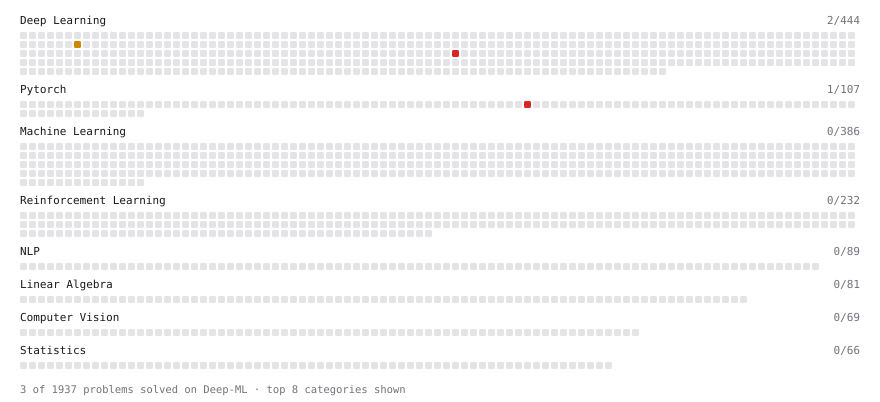

# Deep-ML

My machine learning practice from [Deep-ML](https://www.deep-ml.com). Every solution here was written by hand.

**4** solved · 4 problems · 0 labs · 0 math

[**Browse the interactive portfolio**](https://Elena-Baixy.github.io/deep-ml/) to replay this filling in over time.

## Problems

| | Difficulty | Solved | |
| --- | --- | --- | --- |
| [KV Cache for Efficient Autoregressive Attention](https://www.deep-ml.com/problems/376) | medium | 2026-11-07 | [solution](problems/0376-kv-cache-for-efficient-autoregressive-attention) |
| [KV Cache Memory Budget and Eviction Policy](https://www.deep-ml.com/problems/435) | medium | 2026-11-07 | [solution](problems/0435-kv-cache-memory-budget-and-eviction-policy) |
| [A KV Cache for Autoregressive Decoding](https://www.deep-ml.com/problems/1345) | hard | 2026-11-07 | [solution](problems/1345-a-kv-cache-for-autoregressive-decoding) |
| [Pre-allocated Sliding KV Cache Update](https://www.deep-ml.com/problems/1011) | hard | 2026-11-06 | [solution](problems/1011-pre-allocated-sliding-kv-cache-update) |

---

_This file is regenerated by Deep-ML on every push._
